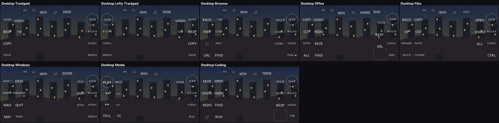
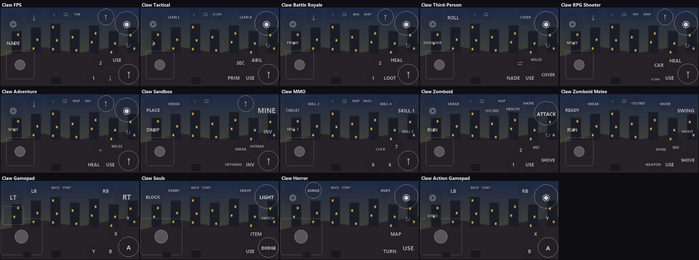
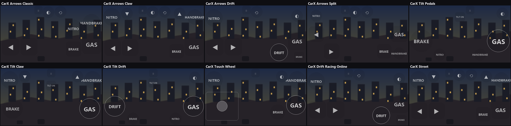
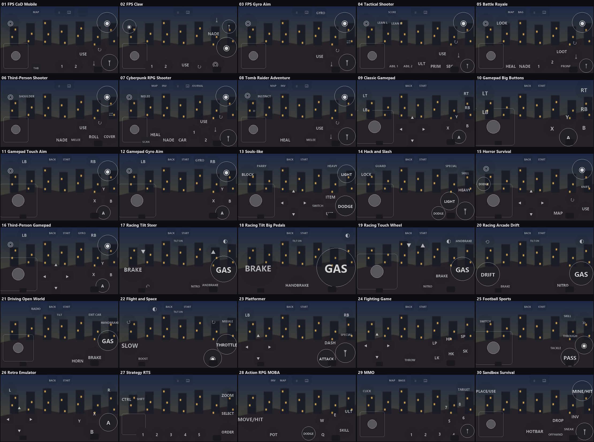

# VoidLink Layouts

Ready-made on-screen control layouts for **[VoidLink](https://apps.apple.com/app/id6755103808)**, the iOS
Moonlight fork for streaming PC games from Sunshine. Built for a small phone held sideways (iPhone 8,
4.7"), so every button is thumb-sized and see-through.

## Files

| File | What's inside |
|---|---|
| `layouts/voidlink-layouts.bin` | **56 layouts**: 30 genre styles, 14 four-finger claw layouts, 8 CarX Street racing layouts, 4 Project Zomboid first-person layouts. Names in `layouts/layout-names.txt`. |
| `layouts/voidlink-desktop-layouts.bin` | **8 desktop layouts** for using Windows itself: trackpad, lefty trackpad, browser, office, files, window control, media, coding. |
| `layouts/voidlink-steam-game-layouts.bin` | **205 per-game layouts**, each named after a Steam game and copied from the best-fitting style above. Which style each game got: `layouts/steam-game-layout-list.txt`. |

## Import

1. **Export your own layouts first** in VoidLink as a backup. Importing may add to or replace what you have; that has not been tested on every version.
2. Get the `.bin` file onto your iPhone (Files, AirDrop, a chat to yourself).
3. In VoidLink's layout tool, choose **Import** and pick the file.
4. Pick a layout by name per game. Nudge any button in the layout editor if it doesn't sit right for your hands.

## The sets

**Claw (4-finger)**: left index = AIM (top-left), right index = FIRE (top-right), left thumb = move stick,
right thumb = invisible swipe-to-look area plus an arc of action buttons.
`Claw FPS, Tactical, Battle Royale, Third-Person, RPG Shooter, Adventure, Sandbox, MMO, Zomboid,
Zomboid Melee, Gamepad, Souls, Horror, Action Gamepad`

**CarX Street racing**: arrow-key versions (◀ ▶ steer, GAS/BRAKE buttons) and tilt-to-steer versions.
Arrow layouts send keyboard keys only; tilt layouts use the virtual gamepad only (tap **TILT ON** first),
so a game never sees two controllers at once.
`CarX Arrows Classic, Arrows Claw, Arrows Drift, Arrows Split, Tilt Pedals, Tilt Claw, Tilt Drift, Touch Wheel`

**30 genre styles**: shooters, gamepad action, souls-like, horror, racing (tilt), flight, platformer,
fighting, sports, retro, RTS, ARPG/MOBA, MMO, sandbox.

**Project Zomboid (first person)**: for the *Project Viewpoint* mod. **1ST/3RD** presses `O`.

**Desktop (everyday Windows use)**: the middle of the screen is an invisible trackpad (slide to move the
mouse); CLICK, right-click and scroll on the right (left in *Lefty*); task shortcuts on the left; Esc,
keyboard, Windows key and Alt+Tab along the top.
`Desktop Trackpad, Lefty Trackpad, Browser, Office, Files, Windows, Media, Coding`
Some shortcut buttons use key combinations that VoidLink's own widgets don't include (new/close/next tab,
Back/Forward, address bar, Up a folder, New folder, Open file, command list, Untab, Comment, Terminal).
They follow the same naming, but they are untested; if one does nothing, replace it in the layout editor.
Media keys are YouTube's.

Previews are approximate mock-ups drawn from the saved layout data over a stand-in scene; VoidLink's own
rendering may differ a little.

## Assumptions and limits

- **Keys are game defaults.** If you rebind keys in a game, change the matching buttons.
- **CarX Street keys are assumed** (arrows drive, Space handbrake, Shift nitro, C camera, R reset, Q/E gears).
  Check the game's controls screen.
- **Layouts with a D-pad use VoidLink's real gamepad D-pad.** Separate arrow buttons send keyboard arrows,
  which controller-only games (e.g. fighting games) ignore.
- VoidLink buttons can only be circles or rounded rectangles, with no colours or images.
- Not affiliated with VoidLink, Moonlight or any game publisher.
